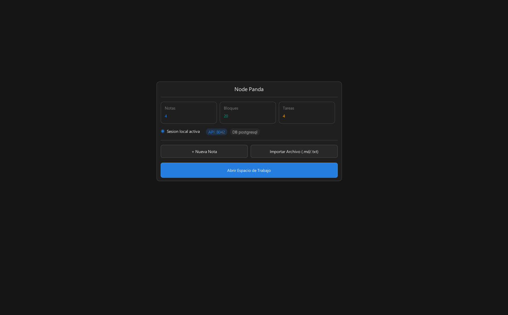
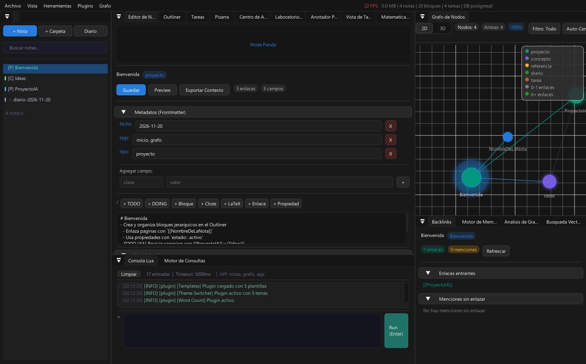
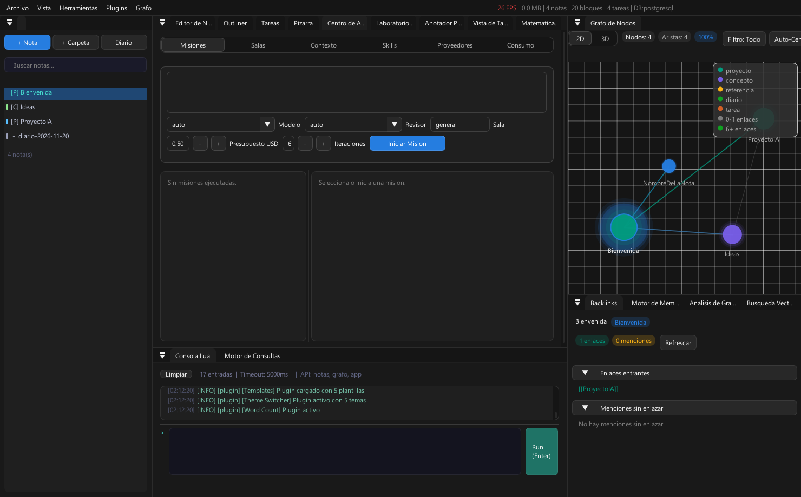
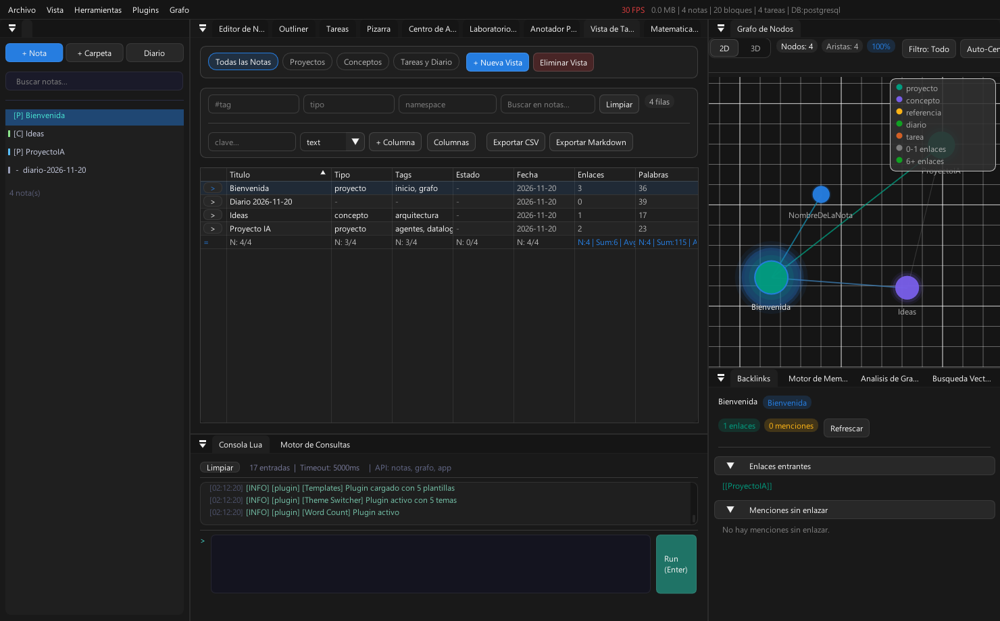
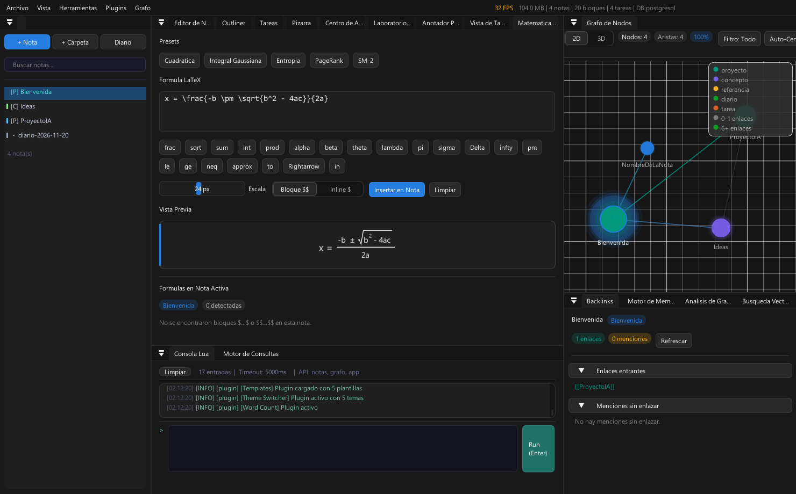
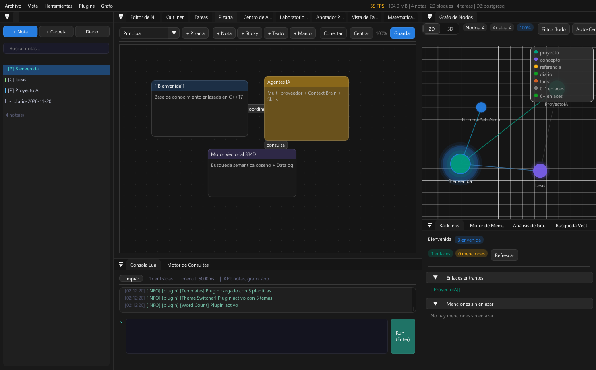
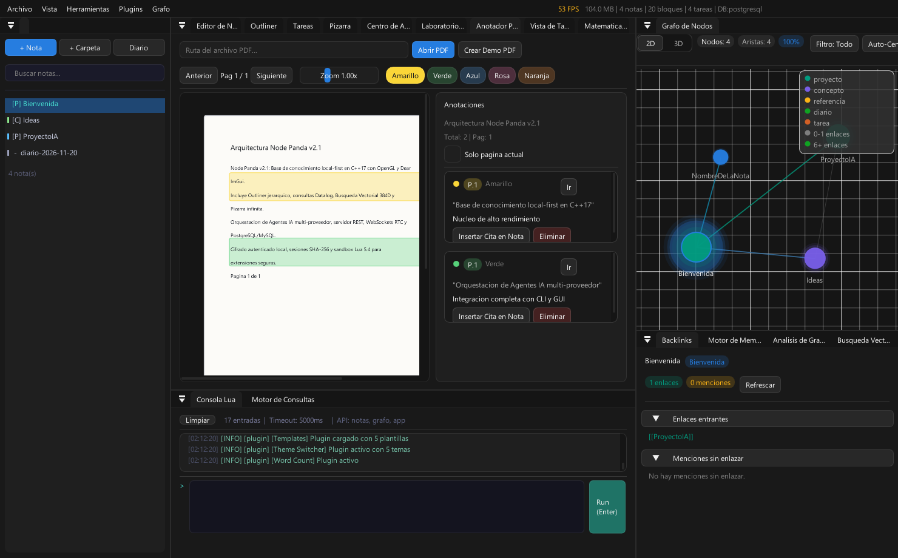
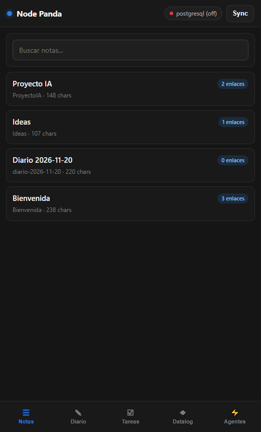

# Node Panda

Plataforma local-first de gestión del conocimiento en grafo, outliner jerárquico y orquestación multi-agente de IA escrita en **C++17 puro** con OpenGL 3.3, Dear ImGui, Lua 5.4, servidor HTTP/REST, WebSocket RTC (RFC 6455), búsqueda vectorial 384D y soporte para **PostgreSQL** y **MySQL**.

---

## Capturas de Pantalla

### Hub de Bienvenida


### Espacio de Trabajo Principal (Explorador, Editor, Grafo 2D/3D, Consola Lua y Backlinks)


### Centro de Agentes de IA Multi-Proveedor


### Vistas Dinámicas de Tabla (Base de Datos sobre Notas y Propiedades)


### Renderizador Nativo de Matemáticas LaTeX (`ImDrawList`)


### Pizarra Visual Infinita


### Anotador Visual de PDF con Citas Enlazadas


### Companion Móvil PWA (Instalable en Red Local)
<p align="center">
  
</p>

---

## Cómo Funciona

Node Panda compila en un único binario nativo (`NodePanda` / `NodePanda.exe`) que puede operar en tres modos complementarios tras la autenticación en terminal:

1. **Aplicación de Escritorio Compilada (`--gui`)**: Interfaz nativa acelerada por GPU (GLFW + OpenGL 3.3 + Dear ImGui Docking) con tema oscuro/claro (`CarbonDark` / `PaperLight`) y 27 paneles acoplables.
2. **Servidor Local / Headless (`--server`)**: Expone simultáneamente la API REST en el puerto `8042`, el servidor de colaboración en tiempo real WebSocket RFC 6455 en el puerto `8043`, y la aplicación web progresiva (PWA) para móviles en `/mobile`.
3. **CLI Interactiva y Consola de Agentes (`chat`, `run`, `query`, `vector`, etc.)**: Permite consultar el grafo, administrar bloques/tareas, sincronizar bases de datos SQL, lanzar misiones de IA y ejecutar diagnósticos directamente desde la terminal.

### Arquitectura de Subsistemas

| Capa | Módulos Principales | Descripción |
| :--- | :--- | :--- |
| **Grafo y Conocimiento** | `NoteManager`, `OutlinerEngine`, `JournalEngine`, `TaskEngine`, `PropertyEngine`, `DatalogEngine`, `Graph`, `ForceLayout` | Notas Markdown con frontmatter YAML, árbol de bloques jerárquicos con UUIDv4, diarios automáticos, tareas `TODO`/`DOING`/`DONE`/`LATER` con prioridades y Kanban, enlaces `[[wikilinks]]`, propiedades `clave:: valor`, consultas Datalog y grafo interactivo 2D/3D con Barnes-Hut. |
| **Motores Avanzados** | `PdfEngine`, `TableViewEngine`, `VectorEngine`, `MathRenderer`, `WhiteboardEngine`, `SRSEngine` | Anotador PDF nativo con resaltados persistentes y citas, tablas editables con filtros/agregaciones/exportación CSV y Markdown, búsqueda semántica híbrida 384D (similitud coseno + TF-IDF), motor AST LaTeX dibujado sobre `ImDrawList`, pizarra infinita y flashcards con Cloze y algoritmo SM-2. |
| **Agentes IA y Laboratorio** | `AgentEngine`, `AiCatalog`, `AiProvider`, `ContextBrain`, `SkillManager`, `UsageLedger`, `DataLab`, `EvolutionEngine` | Orquestación de misiones multi-agente, salas colaborativas, recuperación de contexto desde la bóveda, skills Markdown (`data/skills/`), control de presupuesto/tokens, perfilador CSV + gráficas SVG + evaluador CAD de 14 clases. Compatible con OpenAI, Anthropic, Google Gemini, xAI, DeepSeek, NVIDIA NIM y endpoints locales compatibles con OpenAI. |
| **Tiempo Real y Móvil** | `HttpServer`, `WebSocketRtcServer`, `MobileBridge`, `SyncEngine`, `BackupManager` | API REST embebida, WebSocket RFC 6455 con salas/presencia/CRDT LWW, PWA offline-first instalable desde LAN (`/mobile`, `/manifest.json`, `/sw.js`), snapshots cifrados E2EE y respaldos versionados. |
| **Persistencia y Scripting** | `DatabaseManager`, `AuthManager`, `CryptoEngine`, `LuaManager`, `PluginManager`, `GitManager` | Conectores PostgreSQL y MySQL (modo local y servidor remoto con esquemas en `data/sql/`), autenticación PBKDF2-HMAC-SHA256, motor de plugins en Lua 5.4 con sandbox y control de versiones Git integrado. |

---

## Instalación y Compilación

### Requisitos Previos

- **Compilador C++17**: GCC 11+, Clang 14+ o MSVC 2022.
- **CMake 3.16+** y **Ninja** (o Make / MSBuild).
- **OpenGL 3.3+** (drivers gráficos del sistema para modo `--gui`).
- **Opcional**: `psql` (PostgreSQL) o `mysql` (MySQL) en el `PATH` para sincronización directa con servidores SQL externos, y `git` para versionado automático de notas.
- Las dependencias principales (GLFW 3.4, Dear ImGui docking, Lua 5.4.6 y sol2) se obtienen automáticamente con CMake `FetchContent`.

### Windows (MSYS2 UCRT64 + MinGW-w64)

```powershell
pacman -S --needed mingw-w64-ucrt-x86_64-gcc mingw-w64-ucrt-x86_64-cmake mingw-w64-ucrt-x86_64-ninja

$env:PATH = "C:\msys64\ucrt64\bin;" + $env:PATH
cmake -S . -B build -G Ninja -DCMAKE_BUILD_TYPE=Release
cmake --build build --parallel
```

El ejecutable queda en `build\NodePanda.exe`.

### Windows (Visual Studio / MSVC)

```powershell
cmake -S . -B build -G "Visual Studio 17 2022" -A x64
cmake --build build --config Release --parallel
```

### Linux (Debian / Ubuntu)

```bash
sudo apt-get update && sudo apt-get install -y \
  build-essential cmake ninja-build git pkg-config \
  libgl1-mesa-dev libx11-dev libxrandr-dev libxinerama-dev \
  libxcursor-dev libxi-dev libwayland-dev libxkbcommon-dev

cmake -S . -B build -G Ninja -DCMAKE_BUILD_TYPE=Release
cmake --build build --parallel
```

### Docker y Docker Compose (Servidor Headless + PostgreSQL / MySQL)

El proyecto incluye [`Dockerfile`](Dockerfile) (compilación multi-stage en C++17) y [`docker-compose.yml`](docker-compose.yml) con perfiles para ambos motores SQL:

```bash
# Modo por defecto (Node Panda + PostgreSQL 16)
docker compose up --build -d

# Modo MySQL 8
docker compose --profile mysql up --build -d
```

Puertos expuestos en Docker:
- **`8042`**: API REST y Companion Móvil PWA (`http://localhost:8042/mobile`).
- **`8043`**: Servidor WebSocket RTC (`ws://localhost:8043`).

Variables de entorno soportadas:

| Variable | Valor por defecto | Descripción |
| :--- | :--- | :--- |
| `NODEPANDA_HOST` | `127.0.0.1` (GUI) / `0.0.0.0` (Server) | Dirección de escucha HTTP y WebSocket RTC |
| `NODEPANDA_PORT` | `8042` | Puerto del servidor HTTP/REST y PWA |
| `NODEPANDA_RTC_PORT` | `8043` | Puerto del servidor WebSocket RFC 6455 |
| `NODEPANDA_DB_ENGINE` | `postgresql` | Motor de base de datos (`postgresql` o `mysql`) |
| `NODEPANDA_DB_MODE` | `local` | Modo de conexión (`local` o `server`) |
| `NODEPANDA_DB_HOST` | `127.0.0.1` | Host del servidor SQL |
| `NODEPANDA_DB_PORT` | `5432` / `3306` | Puerto SQL |
| `NODEPANDA_DB_NAME` | `nodepanda` | Nombre de la base de datos |
| `NODEPANDA_DB_USER` | `nodepanda` | Usuario SQL |
| `NODEPANDA_DB_PASSWORD` | _(vacío)_ | Contraseña SQL |
| `NODEPANDA_API_TOKEN` | _(opcional)_ | Token Bearer para proteger rutas `/api/*` en despliegues remotos |
| `OPENAI_API_KEY`, `ANTHROPIC_API_KEY`, `GEMINI_API_KEY`, `XAI_API_KEY`, `DEEPSEEK_API_KEY`, `NVIDIA_API_KEY` | _(opcional)_ | Claves de API para proveedores de agentes IA |

### Pruebas Automatizadas (CTest)

El proyecto incluye una suite de pruebas nativas en C++17 (`tests/nodepanda_tests.cpp`) que valida criptografía, autenticación, outliner, tareas, Datalog, búsqueda vectorial 384D, PDF, vistas de tabla, AST LaTeX, WebSocket RFC 6455 y Companion Móvil PWA:

```bash
cmake -S . -B build -G Ninja -DCMAKE_BUILD_TYPE=Release -DNODEPANDA_BUILD_TESTS=ON
cmake --build build --parallel
ctest --test-dir build --output-on-failure
```

---

## Uso del CLI y Flujo de Autenticación

Al ejecutar `NodePanda` sin argumentos, la CLI solicita primero iniciar sesión (o crear la primera cuenta si no existen usuarios) con lectura de contraseña oculta en terminal, y luego permite elegir entre:

1. Abrir la interfaz gráfica compilada (`--gui`).
2. Levantar el servidor local HTTP + WebSocket RTC + Companion Móvil (`--server`).
3. Abrir la consola interactiva de agentes (`chat`).

```bash
# Inicio interactivo con login en terminal
./build/NodePanda

# Lanzar directamente la interfaz gráfica tras validar sesión
./build/NodePanda --gui

# Lanzar servidor headless en puerto personalizado
./build/NodePanda --server --port 8042
```

### Comandos Principales de la CLI

| Categoría | Comando | Función |
| :--- | :--- | :--- |
| **Autenticación** | `login`, `register`, `logout` | Gestión de cuentas locales y sesión CLI persistente |
| **Agentes IA** | `chat [--name N] [--room R] [--model M]` | REPL interactivo multi-agente |
| **Misiones** | `run "<prompt>" [--model M] [--wait]` / `runs` | Ejecutar e inspeccionar misiones multi-agente |
| **Catálogo y Lab** | `models`, `skills`, `recall <query>`, `profile <csv>`, `analyze <csv>`, `export` | Modelos soportados, skills, contexto y análisis de datos |
| **Conocimiento** | `status`, `list <page\|task\|block\|property\|asset>`, `show --page <nombre>` | Inspección de la bóveda y árbol de bloques |
| **Edición** | `upsert block --target-page P --content T`, `upsert task --content T [--priority A]` | Creación programática de bloques y tareas |
| **Consultas** | `search <texto>`, `query <datalog\|--name nombre>`, `vector <query> [--k 10]` | Búsqueda textual, Datalog y vectorial 384D |
| **PDF y Tablas** | `pdf <demo\|open archivo.pdf\|list>`, `table list` | Anotador PDF y vistas de tabla dinámica |
| **Tiempo Real** | `rtc status`, `mobile [--port 8042]` | Estado WebSocket RTC y URL LAN del Companion PWA |
| **SQL y Sync** | `db <status\|config\|init\|sync\|query>`, `backup <list\|create\|restore\|remove>`, `sync <status\|checksum\|export\|import>` | Administración PostgreSQL/MySQL, respaldos y snapshots E2EE |
| **Diagnóstico** | `doctor` | Verificación de bóveda, índice vectorial, BD, RTC y plugins |

---

## API REST y WebSocket RTC

Cuando el servidor está activo (`--gui` o `--server`), se exponen los siguientes endpoints:

- **PWA Móvil**: `GET /`, `GET /mobile`, `GET /manifest.json`, `GET /sw.js`
- **Estado y Salud**: `GET /api/health`, `GET /healthz`, `GET /api/snapshot`, `GET /api/stats`
- **Notas y Grafo**: `GET /api/notas`, `GET /api/notas/<id>`, `GET /api/grafo`, `GET /api/memoria/buscar?q=...&n=10`
- **Bloques, Tareas y Datalog**: `GET /api/v1/blocks`, `POST /api/v1/blocks`, `GET /api/v1/tasks`, `POST /api/v1/datalog`
- **Vectores, PDF, Tablas y RTC**: `GET /api/v1/vector/search?q=...&k=10`, `GET /api/v1/pdfs`, `GET /api/v1/tables`, `GET /api/v1/rtc`
- **Agentes y Contexto**: `GET /api/runs`, `POST /api/runs`, `GET /api/messages?room=general`, `POST /api/messages`, `GET /api/skills`, `POST /api/context/retrieve`
- **Autenticación y BD**: `POST /api/auth/login`, `POST /api/auth/register`, `GET /api/db/status`, `GET /api/v1/sync`
- **WebSocket RTC (RFC 6455)**: `ws://<host>:8043` (protocolo JSON con mensajes `join`, `presence`, `cursor`, `block_op`, `chat`, `ping`).

---

## Seguridad

Node Panda está diseñado bajo principios **local-first** y **defensa en profundidad**:

1. **Autenticación con Derivación Robusta de Claves (`CryptoEngine` + `AuthManager`)**:
   - Las contraseñas jamás se almacenan en texto plano ni con hashes rápidos simples. Cada cuenta genera una **sal criptográfica única** y deriva el hash mediante **PBKDF2-HMAC-SHA256**.
   - La verificación de hashes y etiquetas MAC utiliza **comparación en tiempo constante** (`constantTimeEquals`) para mitigar ataques de temporización.
   - En terminal, la entrada de contraseña deshabilita el eco de consola (`SetConsoleMode` en Windows / `termios` en POSIX).
   - Las sesiones locales emiten tokens aleatorios con expiración almacenados mediante digest SHA-256 en `.nodepanda/`.

2. **Cifrado Autenticado de Extremo a Extremo (E2EE) para Sincronización**:
   - Los snapshots exportados con `sync export --e2ee-password <clave>` (o desde el panel **Sync & Backups**) derivan clave y flujo cifrado mediante PBKDF2-HMAC-SHA256 + etiqueta de autenticación HMAC-SHA256 verificada antes del descifrado. Si el archivo fue alterado o la clave es incorrecta, la importación se rechaza de inmediato.

3. **Sandbox Estricto para Plugins Lua 5.4 (`LuaManager` + `PluginManager`)**:
   - Los plugins solo reciben librerías seguras (`base`, `string`, `table`, `math`, `utf8`) y APIs controladas del grafo (`notas`, `bloques`, `tareas`, `agentes`, `db`, `grafo`, `app`).
   - Se bloquean primitivas peligrosas (`io`, `os.execute`, `package`, `debug`, `dofile`, `loadfile`).
   - Un hook de conteo de instrucciones impone un **timeout máximo de ejecución** para evitar bucles infinitos que congelen la aplicación.

4. **Protección de Red, Archivos y Base de Datos**:
   - Por defecto, el modo `--gui` enlaza el servidor HTTP y WebSocket a `127.0.0.1` (solo loopback local). La exposición en red (`0.0.0.0`) solo se activa explícitamente en modo `--server` o mediante `NODEPANDA_HOST`.
   - El servidor HTTP aplica lectura completa por `Content-Length` con tope estricto de `1 MiB` (`413 Payload Too Large`), cabeceras defensivas (`X-Content-Type-Options: nosniff`, `X-Frame-Options: SAMEORIGIN`, `Referrer-Policy: no-referrer`) y soporte opcional de autenticación Bearer mediante `NODEPANDA_API_TOKEN` validado en tiempo constante.
   - En despliegues públicos o en LAN compartida se recomienda colocar un proxy inverso con TLS (`nginx`, `Caddy` o `Traefik`) terminando `https://` y `wss://`, y nunca almacenar secretos de producción en el repositorio.
   - Las operaciones sobre rutas de archivos validan nombres y directorios de bóveda/assets para evitar ataques de *path traversal*, y las consultas generadas hacia PostgreSQL y MySQL escapan literales SQL y ejecutan esquemas parametrizados (`data/sql/postgres_schema.sql` y `data/sql/mysql_schema.sql`).
   - Las claves de API de proveedores de IA se leen preferentemente desde variables de entorno y los costos se acotan con límites de presupuesto por misión (`UsageLedger`).

---

## Estructura del Proyecto

```text
Node-Panda/
├── .github/workflows/     # Pipeline CI (compilación Linux C++17 + CTest)
├── include/               # Cabeceras C++17 de motores, paneles, red, seguridad e IA
├── src/                   # Implementación en C++17 puro
├── tests/                 # Suite de pruebas unitarias C++17 (CTest)
├── data/
│   ├── plugins/           # 12 plugins Lua 5.4 integrados
│   ├── skills/            # Skills Markdown para agentes IA
│   ├── sql/               # Esquemas PostgreSQL y MySQL
│   └── panda.png          # Logotipo usado en el Hub de Bienvenida
├── docs/
│   └── screenshots/       # Capturas reales de la aplicación
├── resources/             # Icono y manifiesto de recursos de escritorio
├── CMakeLists.txt         # Configuración de compilación C++17 (GCC / Clang / MSVC)
├── Dockerfile             # Imagen multi-stage C++17 para servidor headless
├── docker-compose.yml     # Orquestación con PostgreSQL 16 y perfil MySQL 8
├── PLUGIN_API.md          # Referencia de API Lua para desarrolladores de plugins
├── contributors.md        # Guía para colaboradores
└── creditos.md            # Créditos y atribuciones de proyectos y librerías
```

---

## Documentación Adicional

- [Guía de Colaboradores (`contributors.md`)](contributors.md)
- [Créditos y Atribuciones (`creditos.md`)](creditos.md)
- [API de Plugins Lua (`PLUGIN_API.md`)](PLUGIN_API.md)
